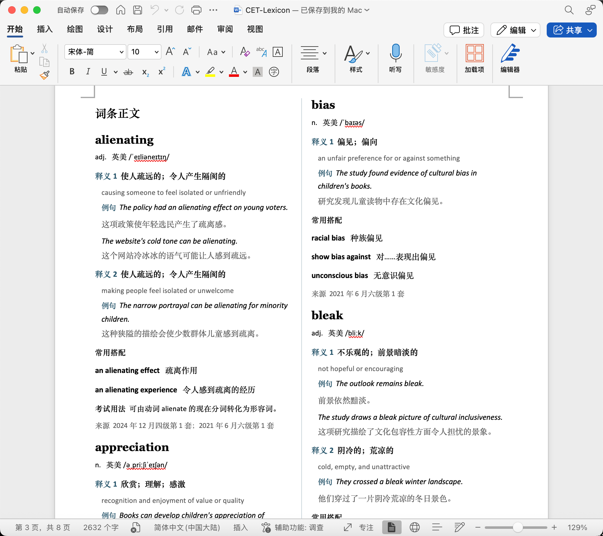
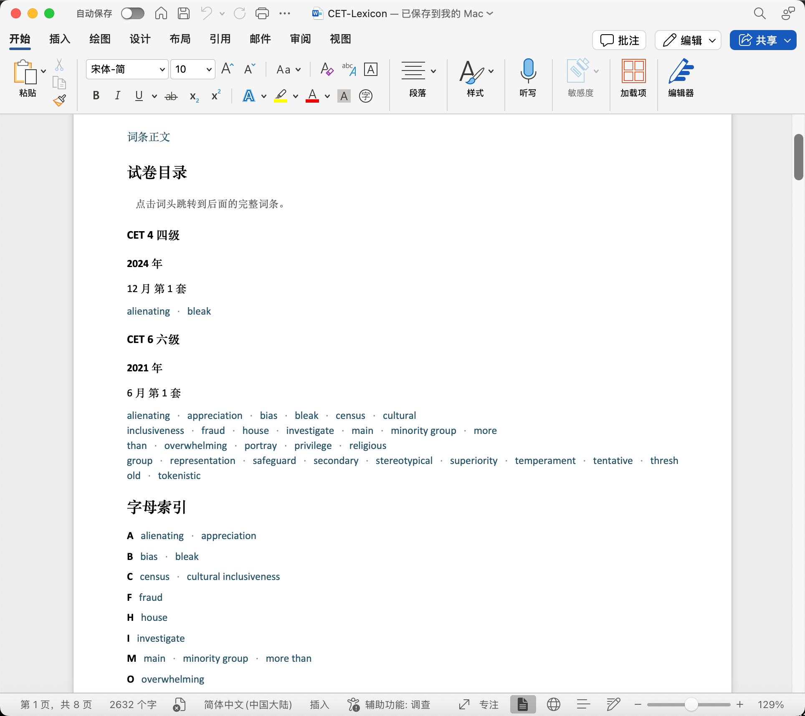

# CET My Word World (MWW) V1.4

一个仅在本机运行的 ChatGPT Desktop / Codex 个人插件：Skill 负责识别查词意图并生成统一词条，本地 stdio MCP 负责安全持久化。

## Word 排版参考

以下为 Microsoft Word 中的实际使用截图。

**双栏正文**：词头、音标、编号释义、双语例句、常用搭配与试卷来源，栏间用细蓝线分隔。



**目录与索引**：试卷目录和字母索引位于正文前，点击词头即可跳转到对应词条。



## 能力边界

- 支持本地运行的 ChatGPT Desktop Work/Codex 线程。
- 不会让纯云端普通聊天自动获得本机文件权限；需要先安装并在本地线程中启用插件。
- 不使用公网服务、账号、数据库或独立网页。
- `vocabulary.json` 是唯一数据源；每次写入自动更新 `CET-Lexicon.docx`，同时保留 Markdown 副本。Word 为默认阅读格式。
- Word 采用双栏词典排版：目录、分级试卷目录和字母索引统一放在正文前，可以点击跳转到完整词条；正文另起一页，包含音标和词性、编号中文释义、双语例句、搭配、考试用法、来源和页码。主词条按字母排列，一个主词条可关联多套试卷。
- 固定样式：14 pt Georgia 词头、10 pt Calibri/宋体正文、9.5 pt 音标和英文简释、9 pt 来源。栏间用 0.5 pt 蓝灰色细线分隔。字体和色彩沿用个人审核选定的风格。
- 只需要 Python 3 标准库，无需安装 python-docx，也不需要启动 Microsoft Word 才能写入。

## 安装

本仓库包含可导入的本地 marketplace：`local-marketplace/`。

1. 在本项目目录运行：

   ```bash
   codex plugin marketplace add ./local-marketplace
   ```

2. 完全退出并重新打开 ChatGPT Desktop。
3. 打开 Plugins Directory，选择 `cet-mww-local` 来源，安装 **CET My Word World**。
4. 在本地 Work/Codex 新对话中用 `@` 选择插件，或直接输入查词请求让 Skill 自动匹配。
5. macOS 首次访问桌面时如出现“文件与文件夹”权限提示，请允许。

可用下面的命令确认 marketplace 已被发现：

```bash
codex plugin marketplace list
```

## 使用

```text
我正在做2024年12月四级第一套。
bleak
alienating 是什么意思？
这个词不要保存：substantial
切换到2025年6月六级第二套。
打开我的单词本。
修改 substantial 的第二个释义。
```

默认数据位置：

```text
~/Desktop/CET-Lexicon/vocabulary.json
~/Desktop/CET-Lexicon/CET-Lexicon.docx
~/Desktop/CET-Lexicon/CET-Lexicon.md
```

测试或需要自定义位置时，可在启动 MCP server 前设置 `CET_MWW_DATA_DIR`。

Word 是自动生成的阅读文件。在聊天里要求修改词条，插件会同步刷新 Word；直接在 Word 中修改不会回写 JSON，下次刷新会被替换。刷新前会保留上一份 `CET-Lexicon.docx.bak`。

保存新词前请关闭 Word 中的单词本。检测到 Word 的占用文件时，插件会要求先关闭，避免未保存的 Word 内容与自动更新冲突。更新后重新打开文件即可看到新内容。

将已有词库生成 Word，而不修改 JSON：

```bash
python3 local-marketplace/plugins/cet-mww/server/export_notebook.py
open ~/Desktop/CET-Lexicon/CET-Lexicon.docx
```

若原单词本正在 Word 中打开，可以另存一份供排版审核的预览：

```bash
python3 local-marketplace/plugins/cet-mww/server/export_notebook.py --preview
open ~/Desktop/CET-Lexicon/CET-Lexicon-双栏细蓝线预览.docx
```

Word 左侧黑色小方块是非打印的段落格式标记，可在“视图 → 显示段落标记”或按 `⌘8` 切换显示；不是单词本中的项目符号，不会打印。

升级已安装的本地插件后，重新执行 `codex plugin add cet-mww@cet-mww-local` 并重启客户端以加载新版本。

## 测试

```bash
python3 -m unittest discover -s local-marketplace/plugins/cet-mww/tests -v
```

端到端测试通过真实 stdio JSON-RPC 进程执行：切换试卷、保存 `bleak` 和 `alienating`、以误拼 `alienatinge` 查询并按规范化词头去重、切换试卷、读取单词本、重启 server 后验证 JSON 中的词条和当前试卷仍存在，并检查 Word 文件内容及内部目录链接。另验证已有数据迁移、Word 占用、导出异常和损坏文件恢复。
